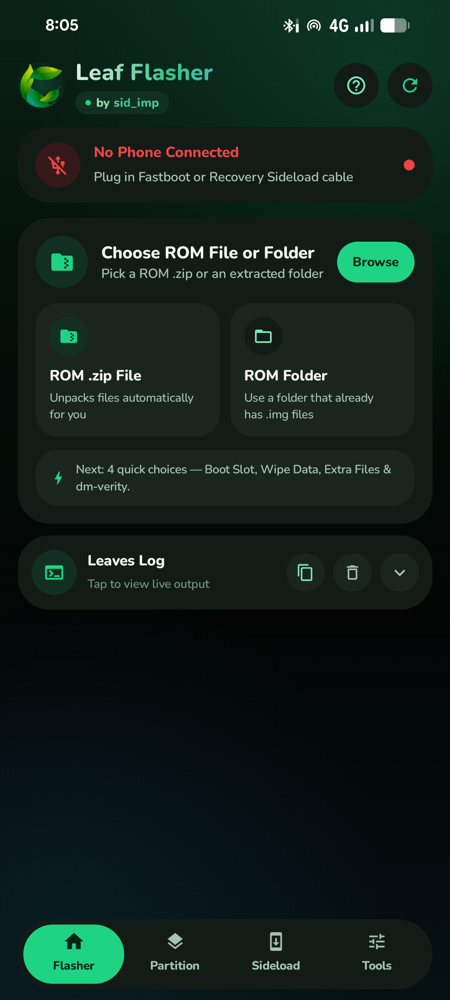
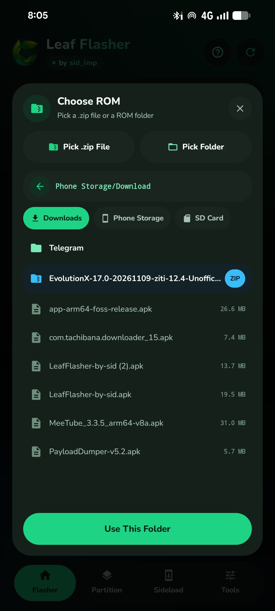
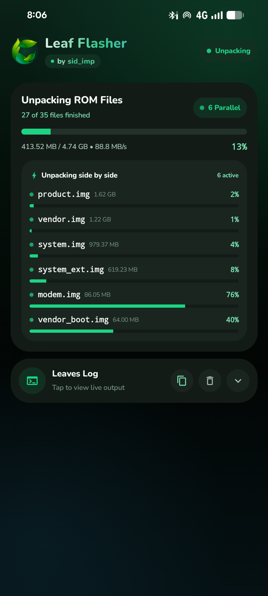
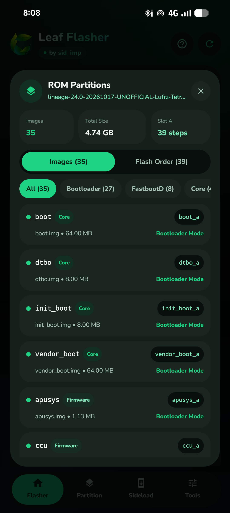
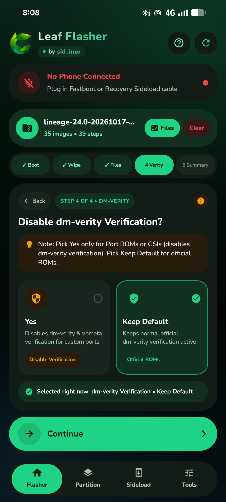
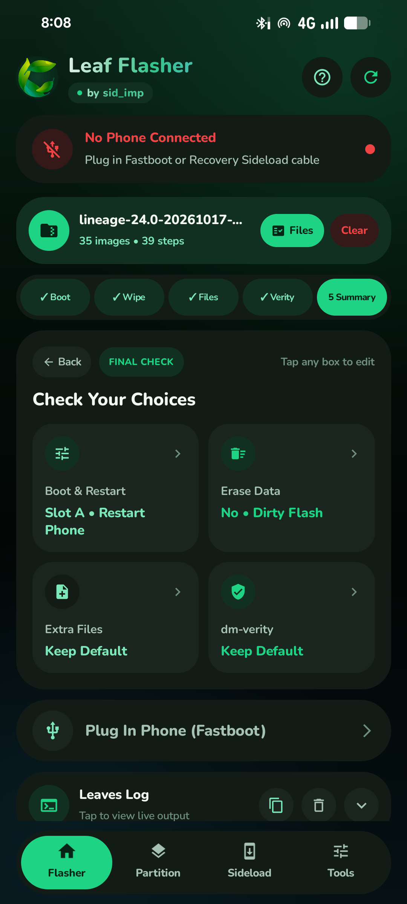
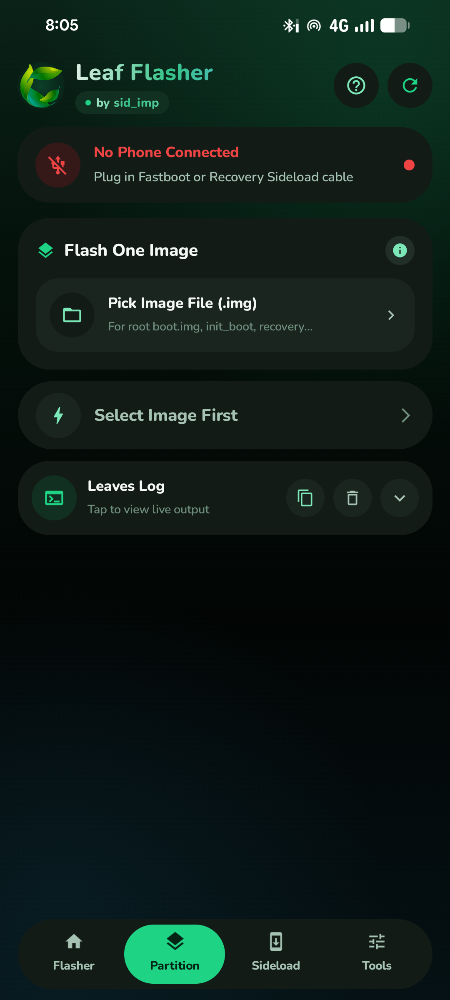
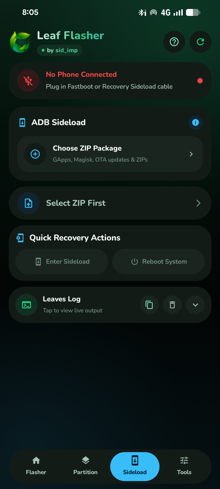
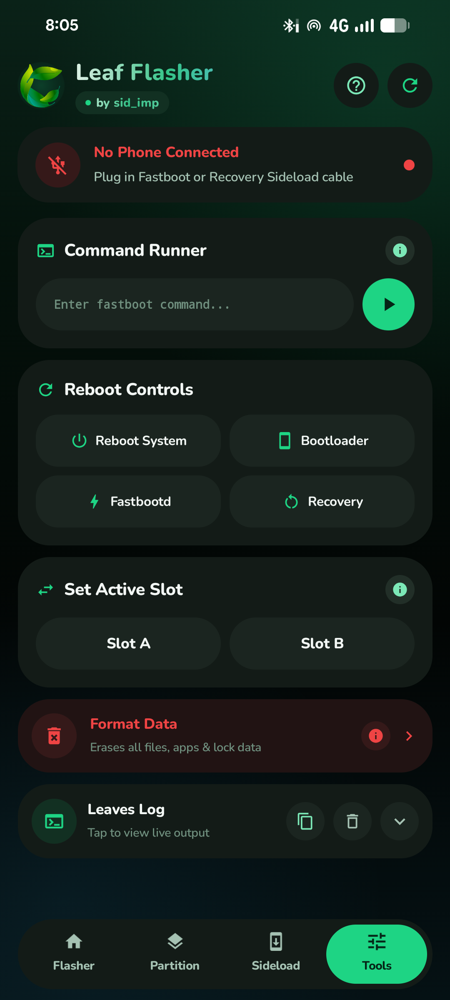

<div align="center">


# Leaf Flasher

**Android-to-Android USB OTG Fastboot, FastbootD, `payload.bin` & ADB Sideload flasher — no PC required.**

by **sid_imp** ([GitHub `@devvsid`](https://github.com/devvsid) · [Telegram `@sid_imp`](https://t.me/sid_imp))

<p>
  <a href="https://github.com/devvsid/LeafFlasher/releases/latest">
    
  </a>
  <a href="https://github.com/devvsid/LeafFlasher/actions/workflows/build-and-release.yml">
    
  </a>
  <a href="https://gitlab.com/fdroid/rfp/-/work_items/4779">
    
  </a>
  <a href="LICENSE">
    
  </a>
  <a href="https://t.me/sid_imp">
    
  </a>
</p>

<p>
  <a href="#-download--verify-apk">Download APK</a> •
  <a href="#-screenshots">Screenshots</a> •
  <a href="#-at-a-glance">At a Glance</a> •
  <a href="#-every-feature-explained">All Features</a> •
  <a href="#-how-to-use-simple-step-by-step">How to Use</a> •
  <a href="#-build--verify-from-source">Build From Source</a> •
  <a href="#-credits--open-source-acknowledgments">Credits</a>
</p>

</div>

---

Leaf Flasher turns any Android phone into a portable flashing station. Plug a second Android phone in over a USB OTG cable and install custom ROMs, stock firmware folders, full OTA `.zip` packages (`payload.bin`), rooted `boot.img` / `init_boot.img` images, or recovery sideload add-ons like GApps and Magisk straight from your phone.

Designed in a clean dark theme with step-by-step guidance and plain, everyday wording so both experienced modders and first-time flashers always know what is happening at every step — **100% offline with zero ads, zero trackers, and no `INTERNET` permission**.

---

## 📦 Download & Verify APK

Every release APK is built transparently from source by [GitHub Actions](.github/workflows/build-and-release.yml) and published under [**GitHub Releases**](https://github.com/devvsid/LeafFlasher/releases) alongside its SHA-256 checksum:

- **Latest Release:** https://github.com/devvsid/LeafFlasher/releases/latest
- **All Releases:** https://github.com/devvsid/LeafFlasher/releases

To verify your downloaded APK matches the published checksum:

```bash
sha256sum -c LeafFlasher-by-sid-v2.0.0.apk.sha256
```

---

## 📸 Screenshots

<div align="center">

<table>
  <tr>
    <td align="center" width="33%">
      <br />
      <b>1. Flasher Home</b><br />
      <sub>Pick ROM ZIP or folder & view device state</sub>
    </td>
    <td align="center" width="33%">
      <br />
      <b>2. ROM & Storage Browser</b><br />
      <sub>Downloads, Phone Storage & SD Card pills</sub>
    </td>
    <td align="center" width="33%">
      <br />
      <b>3. Parallel payload.bin Unpacker</b><br />
      <sub>Multi-worker extraction with live MB/s</sub>
    </td>
  </tr>
  <tr>
    <td align="center" width="33%">
      <br />
      <b>4. ROM Partitions Inspector</b><br />
      <sub>Bootloader, FastbootD & flash order preview</sub>
    </td>
    <td align="center" width="33%">
      <br />
      <b>5. Guided 4-Step Setup</b><br />
      <sub>Slot, Wipe, Extra Files & dm-verity choices</sub>
    </td>
    <td align="center" width="33%">
      <br />
      <b>6. Final Check Summary</b><br />
      <sub>Review or tap any option before flashing</sub>
    </td>
  </tr>
  <tr>
    <td align="center" width="33%">
      <br />
      <b>7. Partition (.img) Flasher</b><br />
      <sub>Flash boot, init_boot, recovery or vbmeta</sub>
    </td>
    <td align="center" width="33%">
      <br />
      <b>8. Native ADB Sideload</b><br />
      <sub>Stream GApps, Magisk & OTA ZIPs in recovery</sub>
    </td>
    <td align="center" width="33%">
      <br />
      <b>9. Tools & Command Runner</b><br />
      <sub>Custom commands, reboots, slot & wipe</sub>
    </td>
  </tr>
</table>

</div>

---

## 🔍 At a Glance

| Tab / Area | What It Does |
| --- | --- |
| **Flasher** | Opens ROM `.zip` / `payload.bin` packages or extracted folders, inspects partitions, walks through 4 simple setup choices, and flashes cleanly with Bootloader ↔ FastbootD auto-handoff. |
| **Partition** | Flashes a single `.img` (`boot.img`, `init_boot.img`, `recovery.img`, `vbmeta.img`, `super_empty.img`, etc.) with automatic filename target matching and sparse splitting. |
| **Sideload** | Native USB ADB + `sideload-host` implementation for flashing GApps, Magisk, KernelSU, and recovery OTA `.zip` files over OTG without external binaries. |
| **Tools** | Run manual `fastboot` or `adb` commands, jump between System / Bootloader / Fastbootd / Recovery, switch A/B slots manually, or format `userdata`. |
| **Privacy & Trust** | Built purely in **Kotlin**. Declares **no `INTERNET` permission** in [`AndroidManifest.xml`](app/src/main/AndroidManifest.xml) and contains zero analytics, ads, or remote calls. |

---

## 💡 Why Leaf Flasher?

Flashing a custom ROM or fixing a soft-bricked Android phone usually means hunting for a laptop, installing platform-tools drivers, and typing long terminal commands.

Leaf Flasher builds the entire Fastboot, FastbootD, Sparse image, OTA `payload.bin` unpacker, and ADB Sideload protocols natively inside a lightweight Kotlin Android app. Just connect two phones with an OTG cable, pick your ROM `.zip` or folder, answer four clear yes/no questions, and tap **Start Flashing**.

---

## ✨ Every Feature Explained

### 1. Live USB OTG Detection (Fastboot, FastbootD & ADB)
- **Automatic USB Mode Recognition:** Plugging in a target device automatically identifies whether it is in **Bootloader (Fastboot)**, **FastbootD (userspace dynamic partitions)**, **Android ADB**, **Recovery ADB**, or **Recovery ADB Sideload**.
- **Color-Coded Top Status Card:** Turns emerald green for Fastboot / FastbootD, ocean blue for ADB / Recovery Sideload, amber while awaiting authorization or reboot reconnection, and crimson when no target phone is plugged in.
- **Strict Hardware Safety Filtering:** Matches only verified Fastboot (`Class 255 / Subclass 66 / Protocol 3`) and ADB (`Class 255 / Subclass 66 / Protocol 1`) USB endpoints while explicitly ignoring MediaTek BROM / Preloader ports (`0x0003`, `0x2000`, `0x2001`) and MTP interfaces so it never touches the wrong USB device.
- **Seamless Fastboot to FastbootD Re-Linking:** Automatically waits for USB re-enumeration when rebooting between Bootloader and FastbootD mid-flash, resuming without user intervention.
- **Adaptive USB Transfer Chunking:** Starts with high-throughput bulk transfers and automatically steps down chunk sizes (`16 KB -> 4 KB -> 1 KB / 512 B`) if a host phone's USB OTG controller drops packets.

### 2. Unified ROM Browser (Phone Storage, Downloads & SD Card)
- **One Place for ZIPs & Folders:** Browse directly inside the app to choose either a ROM `.zip` file or an already-extracted ROM folder.
- **Quick Storage Shortcuts:** One-tap pills to jump straight between **Downloads**, **Phone Storage**, and mounted **SD Card** / **USB Drive** storage volumes.
- **System Picker Always Ready:** Quick **Pick .zip File** and **Pick Folder** buttons also open Android's native Storage Access Framework (SAF) picker, giving access to external SD cards and document providers even on scoped Android versions.
- **Recursive Script & Image Indexing:** Automatically scans subfolders (`images/`, `firmware/`), detects vendor scripts (`.bat` and `.sh`), reads partition aliases (such as `apusys`, `apusys_1`, `preloader_raw`, `super_empty`), and categorizes every extracted file before flashing.
- **Partition Inspector (`Files` Button):** Before flashing, open the **Files** popup to inspect every partition image grouped by category (**Core**, **Firmware**, **VBMeta**, **Logical**, **Super Wipe**), showing whether each image flashes in **Bootloader (Fastboot)** or **FastbootD**, plus its target slot (`_a`, `_b`).

### 3. High-Speed Parallel `payload.bin` Extractor
- **Zero-Copy ZIP Reading:** Reads `payload.bin` directly from uncompressed `.zip` entries using `FileChannel` offsets instead of copying a multi-gigabyte `payload.bin` twice to disk.
- **Multi-Threaded Partition Extraction:** Extracts multiple `.img` files side by side in parallel with live per-worker progress bars, real-time MB/s throughput, and overall percentage tracking.
- **Full OTA Compression Support:** Handles `REPLACE` (Raw), `REPLACE_XZ` (LZMA2 with `BasicArrayCache` buffer pooling), `REPLACE_BZ` (BZip2), `ZSTD` (Zstandard), and instant `ZERO` / `DISCARD` sparse extents.
- **Fastboot Archive Support:** Also unpacks standard compressed Fastboot ROM `.zip` packages containing `.img` images and `flash_all` `.bat` / `.sh` scripts.

### 4. Guided 4-Step Flash Setup + Final Check
After your ROM finishes loading, Leaf Flasher walks you through four plain-English steps — nothing starts flashing until you confirm on the final screen:

1. **Step 1 — Boot Slot & Restart (`Boot`)**
   - Pick **Slot A**, **Slot B**, or **A + B** (flashes firmware/bootloader images on both slots while safely keeping dynamic `super` logical partitions on your chosen active slot only).
   - Choose what happens after flashing finishes: **Restart Phone** (boot to Android), **Bootloader** (return to Fastboot), or **Stay Here**.
2. **Step 2 — Wipe Data (`Wipe`)**
   - **Yes • Clean Flash:** Erases user apps, photos, and accounts (`userdata`) — recommended when switching to a different ROM.
   - **No • Dirty Flash:** Keeps apps and data intact — recommended when updating the same ROM.
3. **Step 3 — Extra `.img` Files (`Files`)**
   - **Yes • Add Files:** Attach or replace any partition image right before flashing — ideal for adding `super_empty.img` or a Magisk / KernelSU patched `boot.img` / `init_boot.img`, with tap-to-remap target partition selection.
   - **No • Keep Default:** Installs the standard images included inside the ROM.
4. **Step 4 — dm-verity Verification (`Verity`)**
   - **Yes (Disable Verification):** Automatically adds `--disable-verity` and `--disable-verification` flags and patches AVB 2.0 header flags on `vbmeta` images for **Port ROMs** and **GSIs**.
   - **Keep Default:** Leaves normal official `dm-verity` verification untouched for official or stock ROMs.
5. **Final Check Summary**
   - Displays all four choices in clear tiles. Tap any tile to open its quick-edit menu right where you tapped, then press **Start Flashing**.

### 5. Pure Focus Mode & Leaves Log Console
- **Distraction-Free Progress Screen:** As soon as extraction, flashing, single-image flashing, or ADB sideload starts, extra setup cards and bottom navigation smoothly hide so the live progress bars, transfer speed, ETA, and **Leaves Log** console expand to fill your screen cleanly.
- **Live Controls:** Supports **Pause**, **Resume**, and **Cancel** during script flashing with per-partition status feedback.
- **Clearable Scrollable Terminal:** Expandable mono-spaced console displaying Fastboot responses, ADB status messages, and exact step timings.

### 6. Partition Tab (Flash One `.img` File)
- **Single-Image Flashing:** Flash individual `.img` files such as `boot.img` (root/kernel), `init_boot.img`, `recovery.img`, `vendor_boot.img`, `dtbo.img`, `vbmeta.img`, or `super_empty.img` to the current active slot without wiping or touching other partitions.
- **Smart Target Guessing + Picker:** Automatically detects the destination partition from the filename and provides a **Change** grid picker if your file has a custom name.
- **Disable AVB Toggle:** Appears automatically whenever `vbmeta` is selected so you can disable AVB verification in one switch.
- **Large Image Sparse Handling:** Automatically splits oversized raw images into Fastboot sparse chunks matching the device's `max-download-size`.

### 7. Sideload Tab (ADB Sideload for Recovery ZIPs)
- **Native Pure-Kotlin ADB Client:** Implements the ADB USB protocol directly without external binaries, automatically generating and persisting a standard 2048-bit RSA keypair inside app storage.
- **Zero-Auth Recovery Sideload Support:** Properly distinguishes `sideload::` banners from normal Android OS ADB, so entering Recovery Sideload never stalls asking for a "USB debugging" popup that does not exist in recovery.
- **Streaming `sideload-host` Transfers:** Sends GApps, Magisk, KernelSU, and OTA `.zip` packages cleanly into Recovery with live byte counter, MB/s transfer speed, and **Cancel Sideload** support.
- **Quick Recovery Actions:** One-tap **Enter Sideload**, **Reboot Recovery**, and **Reboot System** shortcuts.

### 8. Tools Tab & Manual Command Runner
- **Command Runner:** Send custom single commands directly to the connected device (for example `getvar all`, `oem device-info`, `getprop ro.product.device`, or `reboot fastboot`) without typing the `fastboot` or `adb` prefix.
- **Reboot Controls:** Quick 2×2 tiles for **Reboot System**, **Bootloader**, **Fastbootd**, and **Recovery**.
- **Set Active Slot:** Switch active boot slot manually between **Slot A** and **Slot B** on A/B devices.
- **Format Data:** Dedicated crimson action card to wipe `userdata` directly from Fastboot when needed.

### 9. Built-In Guide, `(i)` Help Popups & Adaptive Display
- **4-Step Interactive App Tour (`?` Button):** Opens automatically on first launch and anytime from the top header to explain each tab in plain English.
- **Contextual `(i)` Buttons:** Nearly every option card, menu, and tool has an `(i)` badge explaining *What it does*, *When to use it*, and a *Quick tip*.
- **Adaptive Layout Across Screens:** Scales typography, spacing, dialog bounds, and card grids cleanly across narrow 320dp screens, zoomed display density settings, landscape orientation, and tablets, while drawing edge-to-edge under transparent system bars and keeping the screen awake during USB transfers.

---

## 📱 How to Use (Simple Step-by-Step)

1. **Prepare your cables & phone:** Connect your host phone (running Leaf Flasher) to your target phone using a USB OTG adapter or USB-C-to-USB-C data cable.
2. **Put the target phone in the right mode:**
   - **Bootloader / Fastboot mode** to flash full ROMs, Fastboot packages, or single `.img` files (target bootloader must be unlocked).
   - **Recovery → Apply update → Apply from ADB** if you want to sideload GApps, Magisk, or a recovery OTA ZIP.
3. **Check the top status card:** Wait until it turns **green** (Fastboot / FastbootD) or **blue** (ADB / Recovery Sideload). Tap the refresh button if Android asks for USB permission.
4. **Follow the on-screen tab:**
   - **Flasher tab:** Tap **Choose ROM File or Folder** → pick your `.zip` or folder → choose **Continue** through the 4 options → tap **Start Flashing**.
   - **Partition tab:** Pick one `.img` file → verify Target Partition → tap **Flash Partition**.
   - **Sideload tab:** Pick your `.zip` add-on → confirm phone is waiting in ADB Sideload → tap **Start ADB Sideload**.

> [!CAUTION]
> Flashing system partitions or wiping data modifies critical device software and permanently erases user files when Clean Flash or Format Data is chosen. Always double-check that your ROM package matches your exact device model and back up important data before flashing.

---

## 📋 Requirements

- **Host Device (running Leaf Flasher):** Android 7.0 (API 24) or higher with hardware USB Host / USB OTG support
- **Connection:** Data-capable USB OTG adapter + cable, or USB-C to USB-C data cable
- **Target Device (being flashed):** Unlocked bootloader for Fastboot / FastbootD flashing

---

## 🔨 Build & Verify From Source

Every official APK attached to GitHub Releases in this repository is compiled cleanly from this exact source tree using [`.github/workflows/build-and-release.yml`](.github/workflows/build-and-release.yml) and verified against the pinned Gradle wrapper checksum in [`gradle/wrapper/gradle-wrapper.properties`](gradle/wrapper/gradle-wrapper.properties).

```bash
# 1. Clone the repository
git clone https://github.com/devvsid/LeafFlasher.git
cd LeafFlasher

# 2. Make Gradle wrapper executable (Linux/macOS)
chmod +x gradlew

# 3. Run the unit test suite
./gradlew testDebugUnitTest

# 4. Build the release APK (unsigned unless LEAF_KEYSTORE_* env vars are set)
./gradlew assembleRelease

# Or build a debug APK
./gradlew assembleDebug
```

The compiled release APK is output to:
`app/build/outputs/apk/release/app-release.apk` (or `app-release-unsigned.apk` when no signing environment variables are provided).

On Windows PowerShell, use `.\gradlew.bat testDebugUnitTest assembleRelease`.

*(F-Droid readiness: `dependenciesInfo` is disabled in [`app/build.gradle.kts`](app/build.gradle.kts), store metadata and screenshots live under [`fastlane/metadata/android/en-US/`](fastlane/metadata/android/en-US/), and F-Droid RFP tracking is open at [fdroid/rfp#4779](https://gitlab.com/fdroid/rfp/-/work_items/4779).)*

---

## 🙏 Credits & Open-Source Acknowledgments

Leaf Flasher is built on top of open standards and open-source software from the Android community:

| Project / Library | Role in Leaf Flasher | License |
| --- | --- | --- |
| [**syedinsaf/otaripper**](https://github.com/syedinsaf/otaripper) | Architectural inspiration for zero-copy `payload.bin` parsing, parallel partition extraction, and array buffer pooling in `PayloadDumper` | Apache-2.0 |
| [**Android Open Source Project (AOSP)**](https://android.googlesource.com/platform/system/core/) | Protocol design reference for Fastboot / FastbootD, Android Sparse image chunking, AVB 2.0 `vbmeta` header flags, and ADB USB wire / `sideload-host` framing | Apache-2.0 |
| [**Apache Commons Compress**](https://github.com/apache/commons-compress) | BZip2 decompression stream for OTA payload operations | Apache-2.0 |
| [**Tukaani XZ for Java**](https://github.com/tukaani-project/xz-java) | XZ / LZMA2 decompression and `BasicArrayCache` memory pooling | Public Domain / 0BSD |
| [**luben/zstd-jni**](https://github.com/luben/zstd-jni) | Native Zstandard (`ZSTD`) decompression for modern Android OTA payloads | BSD-2-Clause / BSD-3-Clause |
| [**Jetpack Compose & AndroidX**](https://github.com/androidx/androidx) | Declarative Material 3 UI, lifecycle, DocumentFile SAF bridge, and Core KTX | Apache-2.0 |
| [**Kotlin & kotlinx.coroutines**](https://github.com/Kotlin/kotlinx.coroutines) | Structured concurrency for parallel decompression and USB transfers | Apache-2.0 |
| [**Nunito Font (Google Fonts)**](https://github.com/googlefonts/nunito) | Bundled rounded typography (`app/src/main/res/font/`) | SIL Open Font License 1.1 |

---

## 🌐 Community & License

- **Developer:** `sid_imp`
- **Telegram:** [@sid_imp](https://t.me/sid_imp)
- **GitHub:** [@devvsid](https://github.com/devvsid)
- **F-Droid RFP:** [fdroid/rfp#4779](https://gitlab.com/fdroid/rfp/-/work_items/4779)

Copyright © 2026 **sid_imp**

Licensed under the **Apache License, Version 2.0**. See [`LICENSE`](LICENSE) and [`NOTICE`](NOTICE) for full terms and third-party notices.
